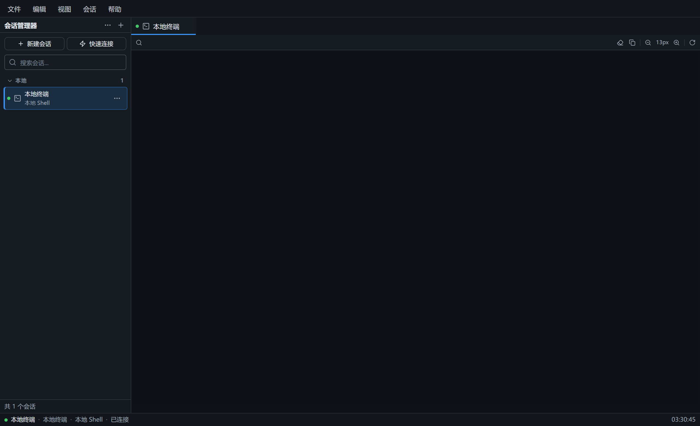
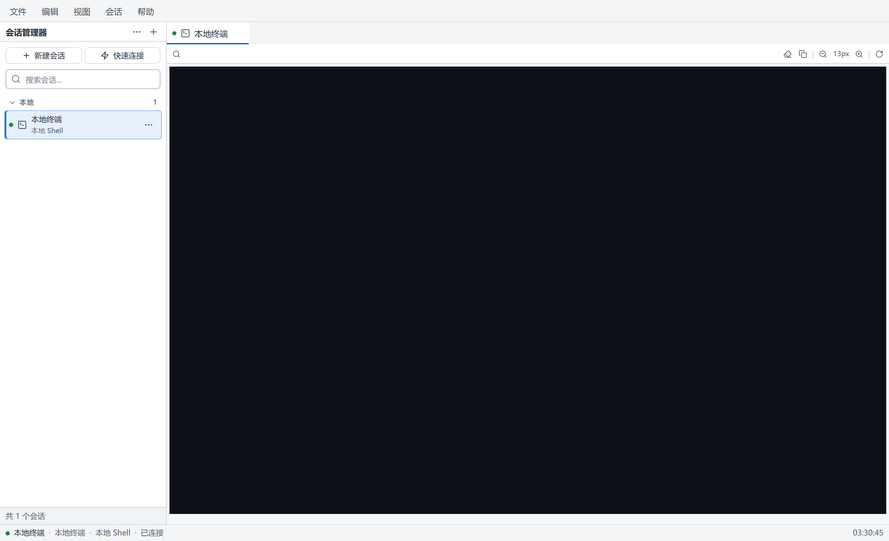
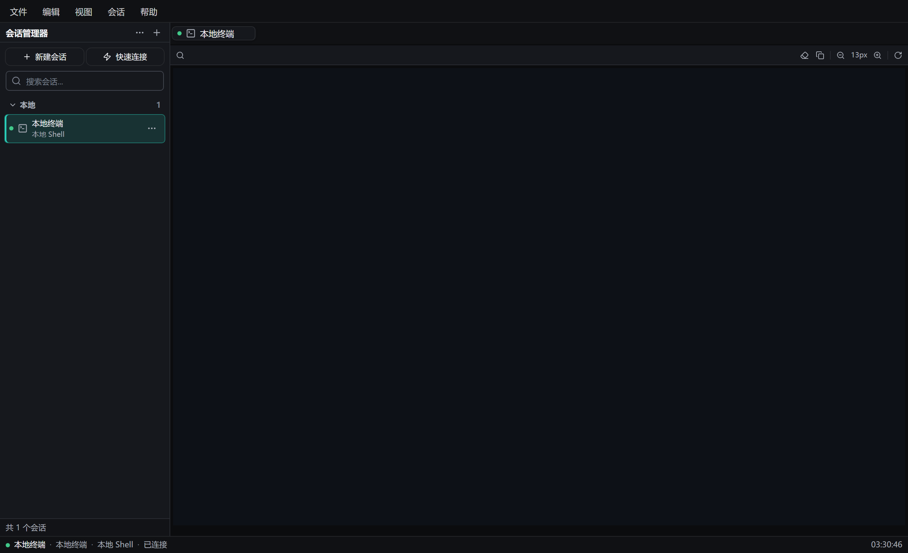
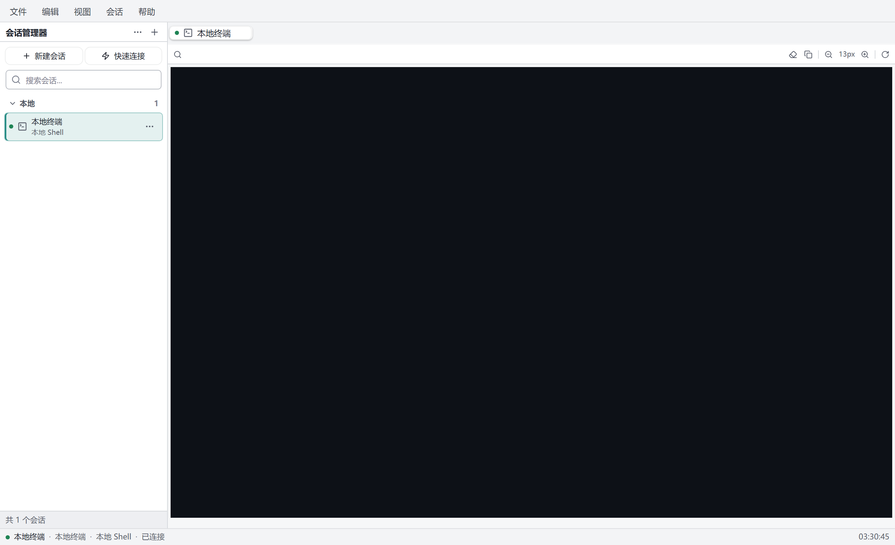
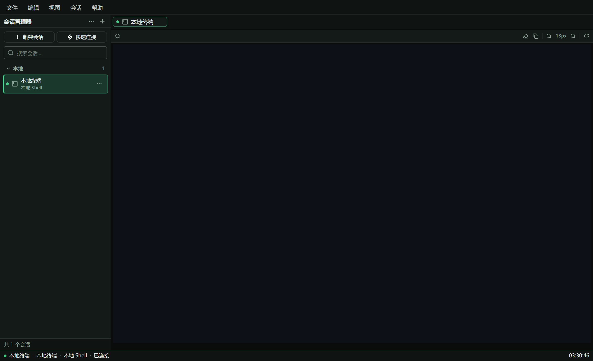
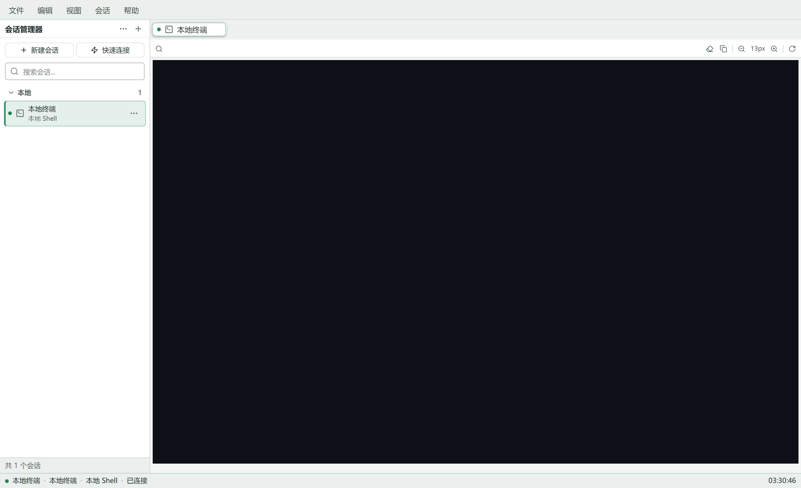
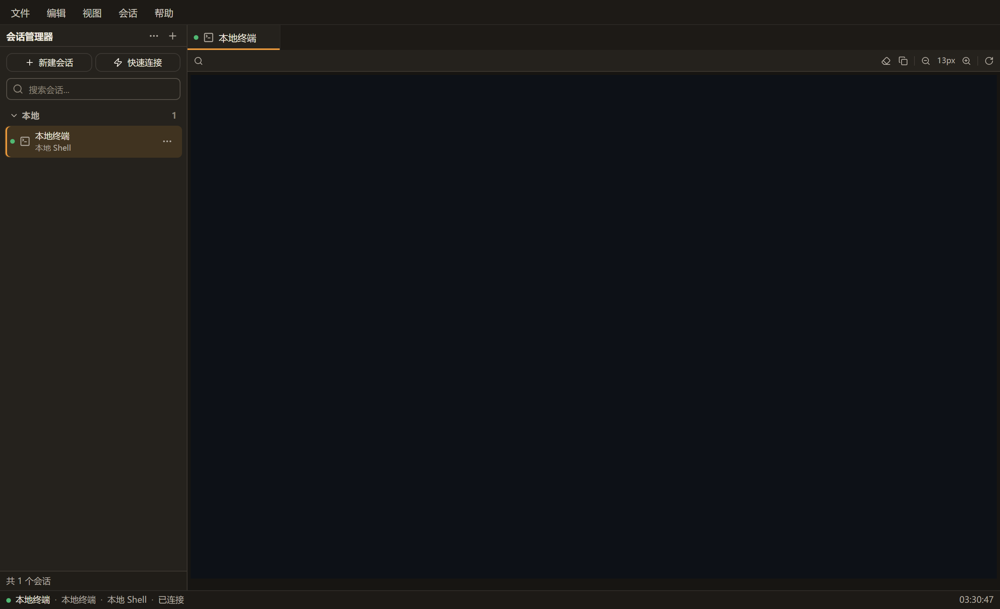
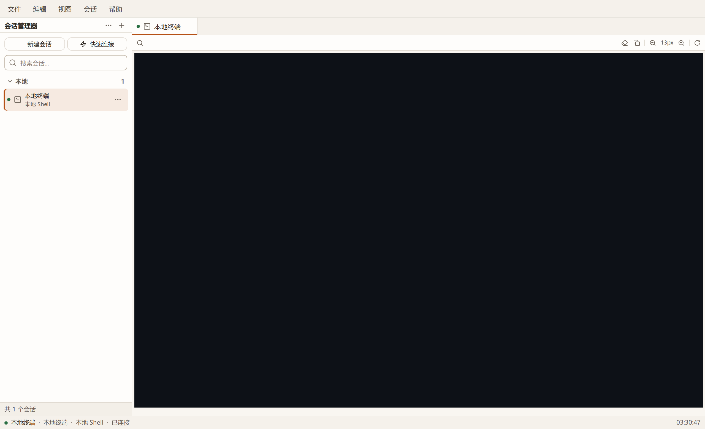

# 现代主题对照（P5 落地后）

> 截图由无头 Chromium 渲染构建产物（无后端）生成，主界面外壳为真实组件。
> 复查方式见文末。

## 一览

| 族             | 明暗  | 锚点                                 | 结构语言                                       |
| -------------- | ----- | ------------------------------------ | ---------------------------------------------- |
| Slate          | 亮/暗 | VS Code Dark Modern / GitHub Primer  | 细线分隔、下划线标签、6/4px 圆角、扁平强调色   |
| Graphite       | 亮/暗 | Linear / Raycast / Win11（纯色模拟） | 药丸标签、无边框按钮、强调条选中、色彩只在焦点 |
| Terminal Green | 亮/暗 | Warp 卡片化 + 经典磷光终端           | 卡片化标签与面板、状态栏即提示行               |
| Sandstone      | 亮/暗 | Solarized 明度体系 + Notion 纸面     | 暖色中性、8px 圆角、暖色阴影                   |

## Slate（现代开发工具基线）

| 暗色                        | 亮色                         |
| --------------------------- | ---------------------------- |
|  |  |

## Graphite（深色极简 · 单色科技感）

| 暗色                              | 亮色                               |
| --------------------------------- | ---------------------------------- |
|  |  |

## Terminal Green（卡片化 · 终端原住民）

| 暗色                                  | 亮色                                   |
| ------------------------------------- | -------------------------------------- |
|  |  |

## Sandstone（现代暖色 · 低蓝光）

| 暗色                                | 亮色                                 |
| ----------------------------------- | ------------------------------------ |
|  |  |

## 经典族（未改动观感，仅对比度修正）

`day` `dim` `aqua-light` `aqua-dark` `holo-light` `holo-dark` 的截图与上面同目录，文件名为 `<主题 id>.png`。

## 复查方式

```powershell
npm run build
# 需要 playwright-core 与 headless chromium；脚本不进仓库（tmp_verify/ 为本地临时目录）
node tmp_verify/real.mjs dist doc/themes
```

脚本会在 `dist/` 生成 `harness.html` 与 `assets/entry.js`（最小 Tauri 宿主 + 入口），
用本地静态服务渲染后逐主题截屏，并打印每个主题的关键颜色探针（正文底色、操作栏、
列表行圆角、选中行、dock 标签高度与激活态），便于与上一次构建逐项比对。

## 自动校验

- `src/theme/contrast.test.ts`：解析 `tokens.css`，对 14 个内置主题校验正文/次要文字/
  微标签/主按钮文字/链接/状态色的 WCAG AA 对比度（正文 4.5:1，其余 3:1）。
- `src/theme/terminalTheme.test.ts`：8 款现代主题必须自带完整 16 色终端板；
  经典族保持从 token 派生。
- `src/theme/themes.test.ts`：每个内置主题恰好属于一个分组与一个族；默认主题为 Slate。
